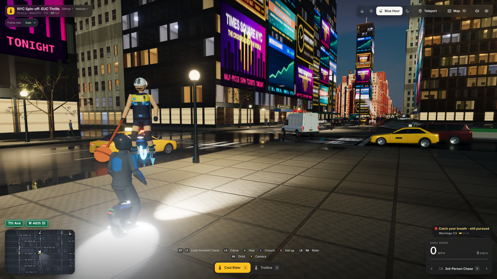
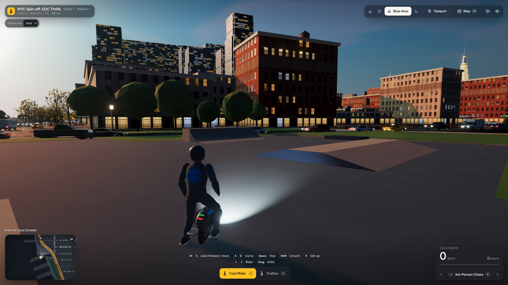

# NYC Spin-off: EUC Thrills (work in progress)

**[▶ Play now](https://vibezzzcoder.github.io/euc-nyc/)**

Ride an electric unicycle through a living 3D Manhattan: hop the kerbs, carve through traffic, mind the crowds.
A free, separately hosted city destination within [*EUC Thrills*](https://github.com/VibezZzCoder/EUC-thrills) by
VibezZzCoder. The riding
(the wheel's physics, the riders and the crashes) comes from *EUC Thrills*. The city is a fork of Mr.doob's
open-source [three.js New York](https://github.com/mrdoob/slop-newyork) (MIT); it is not meant to merge back.

Exploration comes first: roam freely, find a route and enjoy the city. Tricks and skateparks are optional extras.

**Full-roster update (2026-10-31):** choose from all eleven riders, read their rider and wheel profiles, and explore
with selected-rider audio, a pause menu and controller-operated map cursor. Return to EUC Thrills in the same tab
from the title or pause menu. The main game's title menu now offers NYC; the owner reports successful round trips
on phone and computer.

**Collision + park update (2026-11-01):** improved visual tyre/torso clearance and feature-local riding at Thomas
Jefferson and Pier 62, checked with the surrounding city active.

Reviewed riders: **Cool Rider, Trollina, Red Rider, Adonisb2, Maribel Vargas, Wheel in Motion, The Drunkard, FloWithZo,
Seal on a Wheel, Wyldist and Gnarwheel**, with their own looks, wheels and mapped crash sounds. Officer Dorkins stays
NPC-only. Cars, buses and pedestrians are solid: hitting one at speed is a crash. City brands are fictional/generic;
reviewed participant marks, including Wyldist's separately owned SMLS sleeve mark, are the narrow owner-approved
exception. Street, park and landmark names are kept as place names. See the [rights notice](NOTICE-EUC-THRILLS.md).

<p align="center">
  <a href="screenshots/blue-hour-times-square-pursuit.png"></a>
  <a href="screenshots/blue-hour-pier62.png"></a>
</p>

*Blue Hour playtests: a Times Square pursuit and Pier 62 Skatepark. Click either image to view it full-size.*

## Run it

No build step. Serve the folder and open it in an up-to-date browser with hardware acceleration. WebGPU is preferred;
the renderer automatically tries WebGL2 when WebGPU is unavailable:

```bash
python3 -m http.server 8000 --bind 127.0.0.1
# then open http://127.0.0.1:8000
```

If graphics or a required game file fails during startup, the loading screen explains the problem and offers
**Retry**, browser tips and expandable technical details.

### Keyboard and gamepad

Current local controls:

| | Keyboard | Gamepad (Xbox layout) |
|---|---|---|
| Lean forward / back | `W` / `S` | RT / LT, or left stick |
| Carve | `A` / `D` | Left stick |
| Hop (kerbs!) | `Space` | A |
| Crouch | `Shift` | X |
| Get up after a crash | `R` | B |
| Rider picker | `C`; legacy `1` / `2` open/highlight Cool Rider / Trollina | LB / RB open/highlight picker |
| Camera | `V`, `5`–`0` | Y; right stick orbits |
| Map | `M` | Start |
| Pause / menu | `Escape` or `P` | Back / View (button 8) |

Use **Choose rider** on the title screen or **Change rider** while playing. Browse the roster to read each rider's
original profile and wheel details, then use the named **Select** button. Browsing only highlights a choice; the
prepared selection replaces the active one when ready. On a controller, **RS** scrolls the profile details.
Audio/worker failures offer **Retry** / **Cancel**; appearance-module
download failure offers **Reload NYC**, keeping the committed rider and checkpoint rather than the pending choice.
Browsing plays no sample and never swaps immediately. Camera keys `5`–`0` and gamepad Start-to-map keep their existing
roles. In dialogs, Escape/B cancels
the current dialog; booking retains its deliberate controls.

The menu's separated **Return to EUC Thrills main menu** action asks for confirmation; **Keep riding** cancels.
The title's **← EUC Thrills main menu** link leaves in the same tab. Reviewed main-game source lands at its top-level
menu from [the clean root](https://vibezzzcoder.github.io/EUC-thrills/). The owner's phone/computer report establishes
basic manual navigation; detailed input and back/forward-cache (BFCache) behavior remain unspecified.

Pause/menu, Rider selection and the full map freeze riding and city simulation and silence playback. Closing a
dialog restores keyboard focus to its caller; click/tap the city canvas to return to riding keys.

On the full map, **LS** moves the cursor, **RS** pans, **LT / RT** zoom, **A** selects/teleports, **X** centers on you,
**Y** fits Manhattan, and **B / Start** closes. **D-pad** selects map controls or existing search results; use a fresh
**A** to activate. Return held sticks/triggers to neutral after opening or resizing the map.

The on-screen hints switch to gamepad buttons as soon as a pad is used, including on touch-capable screens.
`?rider=trollina` requests a reviewed rider.
The [player guide](PLAYER_GUIDE.md) has everything else: how the wheel rides, crashes, the city and every control.

### Mobile controls — portrait and landscape

Phones and tablets use *EUC Thrills*' touch controls in **both portrait and landscape**. The layout adjusts when you
rotate the device.

The game follows the available browser area when rotating or resizing a window. A size change keeps the city and
your session running and releases held riding, camera and map gestures; lift and touch again to continue. Map controls
use a horizontal row in short windows, and map search uses larger touch-friendly text. Foldable-sized layouts are
covered by automated Chromium checks; physical foldable/Safari validation is still pending.

Use the upper-left **Frame rate / FPS**, **3D resolution / 3D res** and **Graphics** controls to tune rendering independently.
Resolution choices are **100%** (the existing default), **75%** and **50%**, remembered between visits. Lower choices
soften only the 3D scene, leaving menus, HUD, map and touch controls sharp. They can help graphics-limited devices;
riding physics, traffic, city geometry and routes are unchanged. Graphics offers **High** (original appearance), **Medium**
(no screen-space reflections, lower-resolution sun shadows) and **Low** (also no bloom or cast sun shadows), saved for
your next visit. See [rendering options](PLAYER_GUIDE.md#frame-rate-3d-resolution-and-graphics).

- **Ride and steer:** put your left thumb down in the bottom-left to bring up the floating stick. Push up to lean
  forward, down to brake or reverse, and sideways to carve.
- **Hop:** tap **HOP** under your right thumb to jump over kerbs.
- **Charge a bigger hop:** hold **CHARGE** to crouch and charge the jump, then use **HOP**.
- **Tricks:** hold **HOP** for a one-foot air; release and press again while rising for a 180, holding the second
  press to combine them. Hold **CHARGE** in the air for a tuck. Land a 180 and roll backward for a **Fakie** label.
- **Recover:** **GET UP** appears on the right after a crash.
- **Look around:** drag outside the controls to orbit the camera; pinch to zoom.

### Riding and exploring

The speed shows in mph and km/h. When the wheel works hard, tilts back or nears its top speed, a warning appears
above the gauge. Central Park sits behind its wall: ride in by one of its gates (the real entrances, such as 6th Ave
or 7th Ave at 59th St, or 5th Ave at 72nd or 90th St).

One-foot airs, one-foot 180s and held air tucks now have brief landing feedback, with **→ Fakie** for a sustained
backward ride-out after a 180. Keyboard **Space / Shift**, gamepad **A / X**, and touch **HOP / CHARGE** use the
same press/hold rules. See [Simple tricks](PLAYER_GUIDE.md#simple-tricks) for timing and combinations.

The Teleport menu has seventeen stops, including the four East River bridge approaches, the FDR climb, Pier 15,
Little Island, the Hudson River Greenway and **Civic Detention Jail** on White Street. The jail is an original fictional
exterior on the historic Tombs site. Your camera and time-of-day choices are remembered between visits.

All eleven camera views follow your ride. Alongside Chase, Action and First-Person, choose Elevated, Avenue,
Crossroads, Architecture, Overlook, Side Tracking, Panorama or the travelling aerial Director. These replace the
fixed landmark viewpoints with local cinematic framing, clearer-side selection and obstruction handling. Cycle with
**V / Shift+V** or gamepad **Y**, or use the camera menu.

The full map keeps riding input separate from map interaction. Landmark search results can be activated with
Tab/Down and Enter/Space; unsafe or occupied arrivals leave you in place with feedback. The waypoint line is a
direction guide, not a navigable GPS route. In Central Park, Gapstow and Bow bridges have connected rideable decks
and gentle approaches from both banks.

At street level, storefront glazing reveals simulated shelves and counters behind generic shop signs, alongside
distinct residential entrances. Traffic wheels retain each vehicle's alloy, blackout or patrol-wheel style up close.

Search **Pier 62** on the map and click its **skateboard icon** to try the larger waterfront skatepark: banks, two
quarter-pipes, rollers, a manual pad, ledges and a low rail, joined by a clear flat riding line and gentle path entrances.
The slate-blue court sits beside an active asphalt traffic crossing.

**Thomas Jefferson Skatepark** in East Harlem is a compact second venue inspired by the real park's street features:
banks, a low quarter-pipe, a platform with steps and a smooth bypass, two skate benches and rails. Its northern extension
adds a lower banked platform and two rollers, with a low manual pad beside the original line. Search **Thomas
Jefferson** and click its skateboard icon to arrive on the clear central riding line. The other researched skate pins
identify places within the existing city scenery.

Grounded tyre and torso poses adjust for nearby stair edges and walls; these are visual
clearance corrections, with physical wheel motion and collision still authoritative. Street handling stays native:
the wheel's 0.216 m step-up limit still requires hopping Manhattan's 0.22 m kerbs.

The existing Thomas Jefferson and Pier 62 banks, quarter-pipes and rollers have surface- and elevation-local riding
rules: sufficiently steep stalls can turn downhill, qualifying climbs can produce come-back airs, and kicker lips
retain the approach slope for launch. Checked park recovery can restart at rest. Automatic turns do not earn a
player 180 label. This remains free riding on the existing geometry with the existing trick feedback; see
[Riding the skateparks](PLAYER_GUIDE.md#riding-the-skateparks).

Officer Dorkins ambushes you on a police hover-wheel. Paddle knockdowns add warning strikes and fill a small heat
indicator; getting up keeps the chase going. Escape takes sustained distance **and** time out of sight, while he
searches your last known position. The first three knockdowns are warnings; the fourth earns a short comedic booking
at Civic Detention, then release outside with heat cleared. See the [player guide](PLAYER_GUIDE.md#officer-dorkins)
for the chase rules, release and skip controls.

## Developing

- `node --test tests/*.test.*` runs the headless tests. Use Node 24, also needed for the EUC vendor tool's native TypeScript stripping.
- `js/euc/` is generated. Do not edit it. The base is EUC Thrills v1.1.0
  `5f45fff19b258e140833841ba2473069af751a12`; the focused collision/park donor is
  `d37efc07cddc0d76ff7aa585901710d357b8e5a1` (v1.4.0). Only six reviewed donor source files participate: near-solid
  helper, riding rig, tuning, controller, primitive-state copies and world contract. See the
  [exact paths and adaptation scope](NOTICE-EUC-THRILLS.md#adaptation-and-other-notices). Use clean local checkouts
  (`npm ci` in the base checkout) to regenerate or check:

  ```bash
  node tools/vendor-euc.mjs --src ../EUC-thrills --donor ../EUC-thrills-latest
  node tools/vendor-euc.mjs --src ../EUC-thrills --donor ../EUC-thrills-latest --check
  ```

  `js/euc/MANIFEST.json` records both revisions, selected donor declarations and source/output hashes. This is a focused
  dual-source adaptation, with the reviewed eleven playable IDs, NPC-only `cop`, appearances and audio unchanged from
  the base inventory. Preserve inventory/privacy checks and per-file rights. The local graph has **101 modules:
  41 eager / 60 deferred**; selected CPU-only pixel workers retire after preparation. Keep one active rig/audio bank
  plus at most one replacement, with metadata-only bounded preparation; module caching must not retain eleven rigs,
  atlases or decoded audio banks. Validate the actual public-filtered snapshot separately from local tests.
- three.js (one pinned dev commit) and the Inter and Overpass fonts are kept in the repo (`vendor/three/`, `fonts/`),
  so the game loads from its own host only. `node tools/vendor-three.mjs` fetches them again (to move three.js, change
  the commit in the tool first); `--check` confirms they are unchanged and complete.

### Fork authors and coding agents

**[Read the public fork guide](FORK_GUIDE.md)** before repurposing the roster. Independently branded forks with
original characters are encouraged. MIT code and CC BY original assets have no EUC Thrills branding condition;
real identities, supplied logos, contributed recordings and SMLS have separate rights. For an independent game,
replace identity-bearing material unless separately permitted. Hiding chooser entries or renaming riders is not
removal: trace imports, embedded payloads, audio and actual distributed output. Keeping the name grants no rights.

## License and data

- Code: [MIT License](LICENSE). The city (Slop New York) © 2026 Mr.doob; the EUC spin-off's own code (riding the
  city, the HUD, touch controls, sound, the park gates) © 2026 VibezZzCoder. Keep both copyright lines in every copy.
- *EUC Thrills* code: MIT, © 2026 VibezZzCoder (`js/euc/LICENSE`). Original rider/wheel asset work: CC BY 4.0,
  **excluding real identities and the supplied/third-party material identified in the notice**. Assets from
  *EUC Thrills* by VibezZzCoder — CC BY 4.0 — https://github.com/VibezZzCoder/EUC-thrills. See
  [NOTICE-EUC-THRILLS.md](NOTICE-EUC-THRILLS.md), which must travel with every copy. Audio files and their licences
  are listed in [audio/euc/PROVENANCE.md](audio/euc/PROVENANCE.md). Adonisb2/Maribel/Wyldist/Gnarwheel contributed
  recordings are not CC BY; Gnarwheel's original synthesized alarm is separately CC BY. Seal's crash mixes original
  CC BY work with CC0 bark. Trollina's crash and Drunkard's crash/stumble have generated vocals outside the blanket
  CC BY claim. The owner considers existing participant permissions applicable to NYC within EUC Thrills; this
  records that position, not independently verified expanded grants or permission for unrelated downstream games.
- Geographic data: NYC Open Data and © [OpenStreetMap contributors](https://www.openstreetmap.org/copyright) (ODbL).
  The OpenStreetMap-derived parts of `js/nyc-geodata.js` are a derivative database under the ODbL and stay openly
  available in this repository. These credits are also shown in the game, on the full map (`M`).
- three.js: MIT, © 2010-2026 three.js authors (`vendor/three/LICENSE`). Inter and Overpass: SIL Open Font License 1.1
  (`fonts/OFL-Inter.txt`, `fonts/OFL-Overpass.txt`). Third-party data and dependencies keep their own licenses.

This project is not affiliated with or endorsed by Mr.doob, any rider, or any manufacturer or brand.
