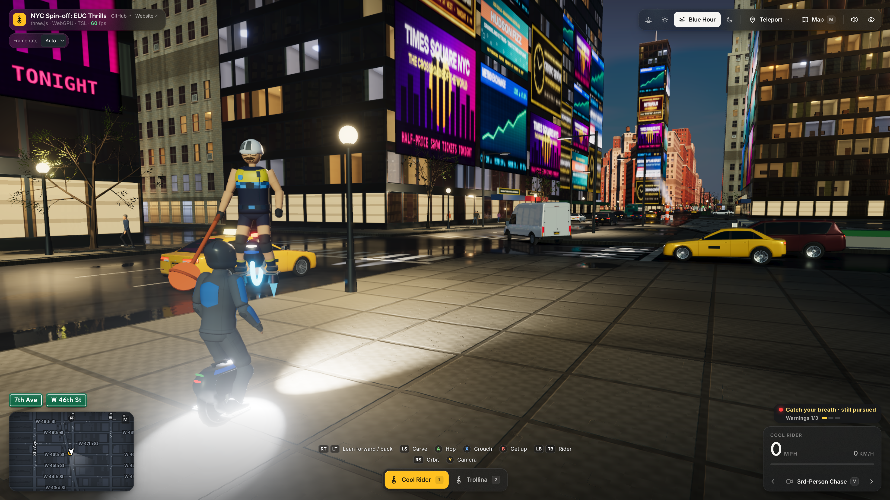
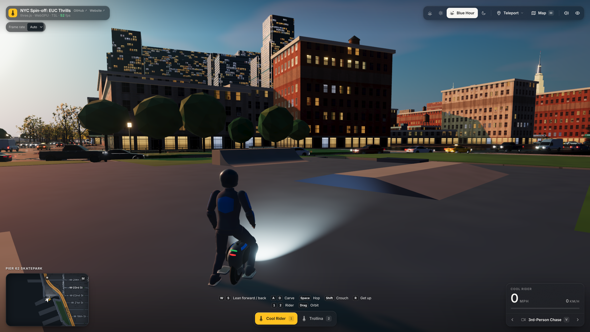

# NYC Spin-off: EUC Thrills (work in progress)

**[▶ Play now](https://vibezzzcoder.github.io/euc-nyc/)**

Ride an electric unicycle through a living 3D Manhattan: hop the kerbs, carve through traffic, mind the crowds.
A free side project of [*EUC Thrills*](https://github.com/VibezZzCoder/EUC-thrills) by VibezZzCoder. The riding
(the wheel's physics, the riders and the crashes) comes from *EUC Thrills*. The city is a fork of Mr.doob's
open-source [three.js New York](https://github.com/mrdoob/slop-newyork) (MIT); it is not meant to merge back.

Status: early. Riders: Cool Rider (`1`) and Trollina (`2`). Cars, buses and pedestrians are solid: hitting one at
speed is a crash. Real-world brands are replaced with fictional ones. Street, park and landmark names are kept as
place names.

<p align="center">
  <a href="screenshots/blue-hour-times-square-pursuit.png"></a>
  <a href="screenshots/blue-hour-pier62.png"></a>
</p>

*Blue Hour playtests: a Times Square pursuit and Pier 62 Skatepark. Click either image to view it full-size.*

## Run it

No build step. Serve the folder and open it in an up-to-date browser with hardware acceleration. WebGPU is preferred;
the renderer automatically tries WebGL2 when WebGPU is unavailable:

```bash
python3 -m http.server 8000 --bind 127.0.0.1
# then open http://127.0.0.1:8000
```

If graphics or a required game file fails during startup, the loading screen explains the problem and offers
**Retry**, browser tips and expandable technical details.

### Keyboard and gamepad

| | Keyboard | Gamepad (Xbox layout) |
|---|---|---|
| Lean forward / back | `W` / `S` | RT / LT, or left stick |
| Carve | `A` / `D` | Left stick |
| Hop (kerbs!) | `Space` | A |
| Crouch | `Shift` | X |
| Get up after a crash | `R` | B |
| Rider | `1` / `2` | LB / RB |
| Camera | `V`, `5`–`0` | Y; right stick orbits |
| Map | `M` | Start |

The on-screen hints switch to gamepad buttons as soon as a pad is used. `?rider=trollina` in the URL picks a rider.
The [player guide](PLAYER_GUIDE.md) has everything else: how the wheel rides, crashes, the city and every control.

### Mobile controls — portrait and landscape

Phones and tablets use *EUC Thrills*' touch controls in **both portrait and landscape**. The layout adjusts when you
rotate the device.

The game follows the available browser area when rotating or resizing a window. A size change keeps the city and
your session running and releases held riding, camera and map gestures; lift and touch again to continue. Map controls
use a horizontal row in short windows, and map search uses larger touch-friendly text. Foldable-sized layouts are
covered by automated Chromium checks; physical foldable/Safari validation is still pending.

- **Ride and steer:** put your left thumb down in the bottom-left to bring up the floating stick. Push up to lean
  forward, down to brake or reverse, and sideways to carve.
- **Hop:** tap **HOP** under your right thumb to jump over kerbs.
- **Charge a bigger hop:** hold **CHARGE** to crouch and charge the jump, then use **HOP**.
- **Recover:** **GET UP** appears on the right after a crash.
- **Look around:** drag outside the controls to orbit the camera; pinch to zoom.

### Riding and exploring

The speed shows in mph and km/h. When the wheel works hard, tilts back or nears its top speed, a warning appears
above the gauge. Central Park sits behind its wall: ride in by one of its gates (the real entrances, such as 6th Ave
or 7th Ave at 59th St, or 5th Ave at 72nd or 90th St).

The Teleport menu has seventeen stops, including the four East River bridge approaches, the FDR climb, Pier 15,
Little Island, the Hudson River Greenway and **Civic Detention Jail** on White Street. The jail is an original fictional
exterior on the historic Tombs site. Your camera and time-of-day choices are remembered between visits.

All eleven camera views follow your ride. Alongside Chase, Action and First-Person, choose Elevated, Avenue,
Crossroads, Architecture, Overlook, Side Tracking, Panorama or the travelling aerial Director. These replace the
fixed landmark viewpoints with local cinematic framing, clearer-side selection and obstruction handling. Cycle with
**V / Shift+V** or gamepad **Y**, or use the camera menu.

At street level, storefront glazing reveals simulated shelves and counters behind generic shop signs, alongside
distinct residential entrances. Traffic wheels retain each vehicle's alloy, blackout or patrol-wheel style up close.

Search **Pier 62** on the map and click its **skateboard icon** to try the larger waterfront skatepark: banks, two
quarter-pipes, rollers, a manual pad, ledges and a low rail, joined by a clear flat riding line and gentle path entrances.
The slate-blue court sits beside an active asphalt traffic crossing.

**Thomas Jefferson Skatepark** in East Harlem is a compact second venue inspired by the real park's street features:
banks, a low quarter-pipe, a platform with steps and a smooth bypass, two skate benches and rails. Its northern extension
adds a lower banked platform and two rollers, with a low manual pad beside the original line. Search **Thomas
Jefferson** and click its skateboard icon to arrive on the clear central riding line. The other researched skate pins
identify places within the existing city scenery.

Officer Dorkins ambushes you on a police hover-wheel. Paddle knockdowns add warning strikes and fill a small heat
indicator; getting up keeps the chase going. Escape takes sustained distance **and** time out of sight, while he
searches your last known position. The first three knockdowns are warnings; the fourth earns a short comedic booking
at Civic Detention, then release outside with heat cleared. See the [player guide](PLAYER_GUIDE.md#officer-dorkins)
for the chase rules, release and skip controls.

## Developing

- `node --test tests/*.test.*` runs the headless tests (Node 18 or newer).
- `js/euc/` is generated. Do not edit it. To update it from a local EUC Thrills checkout (`npm ci` done there), run
  `node tools/vendor-euc.mjs --src <path-to-EUC-thrills>`. Run it with `--check` to
  confirm the folder is current. The tool only keeps the riders in scope, and it fails if anything from a real-person
  rider reaches the output.
- three.js (one pinned dev commit) and the Inter and Overpass fonts are kept in the repo (`vendor/three/`, `fonts/`),
  so the game loads from its own host only. `node tools/vendor-three.mjs` fetches them again (to move three.js, change
  the commit in the tool first); `--check` confirms they are unchanged and complete.

## License and data

- Code: [MIT License](LICENSE). The city (Slop New York) © 2026 Mr.doob; the EUC spin-off's own code (riding the
  city, the HUD, touch controls, sound, the park gates) © 2026 VibezZzCoder. Keep both copyright lines in every copy.
- *EUC Thrills* code: MIT, © 2026 VibezZzCoder (`js/euc/LICENSE`). Rider and wheel assets: CC BY 4.0. Assets from
  *EUC Thrills* by VibezZzCoder — CC BY 4.0 — https://github.com/VibezZzCoder/EUC-thrills. See
  [NOTICE-EUC-THRILLS.md](NOTICE-EUC-THRILLS.md), which must travel with every copy. Audio files and their licences
  are listed in [audio/euc/PROVENANCE.md](audio/euc/PROVENANCE.md). Trollina's crash vocal is machine-generated and is
  not covered by CC BY 4.0.
- Geographic data: NYC Open Data and © [OpenStreetMap contributors](https://www.openstreetmap.org/copyright) (ODbL).
  The OpenStreetMap-derived parts of `js/nyc-geodata.js` are a derivative database under the ODbL and stay openly
  available in this repository. These credits are also shown in the game, on the full map (`M`).
- three.js: MIT, © 2010-2026 three.js authors (`vendor/three/LICENSE`). Inter and Overpass: SIL Open Font License 1.1
  (`fonts/OFL-Inter.txt`, `fonts/OFL-Overpass.txt`). Third-party data and dependencies keep their own licenses.

This project is not affiliated with or endorsed by Mr.doob, any rider, or any manufacturer or brand.
